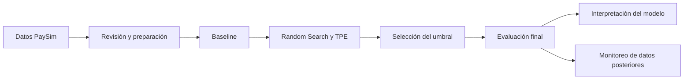

# Detección de fraude en transacciones con PaySim

Aplicación de clasificación y monitoreo de fraude financiero con XGBoost, MLflow y Streamlit. Proyecto del curso Machine Learning Engineering III.

[Descarga la última versión](https://github.com/jorgesialer/Proyecto-mle-fraude/releases/latest) · [Capturas de evidencia](docs/EVIDENCIAS.md)

Esta aplicación identifica transacciones fraudulentas en PaySim y monitorea el desempeño del modelo en periodos posteriores. El proyecto integra preparación de datos, validación temporal, optimización con Random Search y TPE, interpretación de predicciones y un panel de monitoreo.

## Datos y problema

El archivo contiene **6.362.620 transacciones**, de las cuales **8.213 son fraudes**. Es un problema de clasificación con un fuerte desbalance de clases. El dataset está disponible en [Kaggle](https://www.kaggle.com/datasets/charlesbeauchamp/ps-20174392719-1491204439457-logcsv); el [diccionario de datos](docs/DATA_DICTIONARY.md) describe las columnas originales y las variables derivadas.

El modelo utiliza saldos anteriores y posteriores a la operación para analizar transacciones registradas. El pipeline excluye `isFlaggedFraud`, los identificadores y la etiqueta de los predictores.

## Arquitectura del proyecto



El proyecto aplica el corte temporal de la consigna: referencia hasta el step 400 y producción desde 401. El primer bloque contiene periodos independientes para seleccionar el modelo, ajustar el umbral y evaluar el resultado final.

| Uso | Steps | Transacciones | Fraudes |
| --- | --- | ---: | ---: |
| Entrenamiento y búsqueda | 1–250 | 3.248.292 | 2.841 |
| Ajuste del umbral | 251–300 | 825.358 | 560 |
| Evaluación offline | 301–400 | 1.713.380 | 1.076 |
| Monitoreo de producción simulada | 401–743 | 575.590 | 3.736 |

### Entrenamiento y optimización

El entrenamiento compara un predictor de referencia (`DummyClassifier`) con un árbol de decisión y optimiza XGBoost mediante **Random Search** y **TPE** en Optuna. Cada método evalúa diez configuraciones en tres ventanas temporales: 60 ajustes de XGBoost.

| Método | Mejor AP media de validación | Tiempo de búsqueda |
| --- | ---: | ---: |
| Árbol de referencia | 0,994281 | Ver notebook 02 |
| Random Search | 0,997795 | 6,97 minutos |
| TPE | 0,997233 | 8,99 minutos |

Random Search obtiene la mayor AP media de esta comparación. La selección final utiliza XGBoost con 90 árboles y profundidad 3. La validación maximiza F2 para fijar el umbral **0,974192**. Esta métrica prioriza la detección de fraudes y considera las falsas alarmas. El modelo mantiene el mismo umbral durante la evaluación y el monitoreo.

Los detalles del espacio de búsqueda y de la validación están en el [protocolo de optimización](docs/SEARCH_PROTOCOL.md) y el [protocolo de evaluación](docs/EVALUATION_PROTOCOL.md). El resultado corresponde a esta semilla y a este presupuesto; no permite concluir que Random Search siempre sea mejor que TPE.

### Resultados

| Periodo | AP | Precisión | Recall | F2 | Fraudes detectados | Fraudes omitidos | Falsas alarmas |
| --- | ---: | ---: | ---: | ---: | ---: | ---: | ---: |
| Evaluación offline | 0,999269 | 98,53 % | 99,63 % | 0,994065 | 1.072 | 4 | 16 |
| Producción simulada | 0,999668 | 99,81 % | 99,44 % | 0,995125 | 3.715 | 21 | 7 |

El umbral 0,5 obtiene F2 ligeramente mayor en la prueba offline. El proyecto conserva el umbral elegido en validación para mantener la independencia de esa prueba. Los scores del modelo no representan probabilidades calibradas.


### Interpretación

El módulo de interpretación combina SHAP global y local, importancia por permutación y curvas PDP/ICE. La discrepancia del débito de origen y el saldo final de origen concentran las mayores contribuciones. El análisis incluye fraudes detectados, operaciones legítimas y errores del modelo.


Las explicaciones utilizan una muestra uniforme de 20.000 transacciones de prueba, que contiene 16 fraudes. Como hay variables relacionadas entre sí, la permutación y las curvas deben interpretarse con cuidado. Los resultados describen el comportamiento del modelo en PaySim; no demuestran causalidad ni garantizan el mismo desempeño con datos bancarios reales.

### Monitoreo

El panel muestra desempeño, faltantes, cambios de distribución y explicaciones. El monitoreo agrupa las transacciones en ventanas de 50 steps y compara sus distribuciones con una muestra fija de referencia. PSI y KS con corrección BH detectan cambios de distribución; ADWIN analiza la secuencia de errores.

La última ventana presentó alertas de distribución en siete variables. Las métricas no cruzaron los límites de desempeño establecidos y ADWIN no detectó cambios en los errores observados. Una prueba independiente con etiquetas alteradas comprueba la respuesta del detector ante un cambio conocido. Ese escenario no participa en las métricas anteriores.


Las etiquetas ya están disponibles en el dataset, por eso se puede evaluar cada ventana. En una operación real habría que esperar la confirmación del fraude. Las alertas sirven para investigar; no activan un reentrenamiento automático.

## Archivos para revisar

| Carpeta o archivo | Contenido |
| --- | --- |
| `notebooks/` | Los cuatro notebooks solicitados: datos, entrenamiento, interpretación y monitoreo |
| `data/` | Una muestra del CSV e indicaciones para obtener el dataset completo |
| `app.py` | Aplicación de monitoreo en Streamlit |
| `src/` | Código que utilizan los notebooks para preparar, entrenar y evaluar |
| `reports/` | Resultados, gráficos y reportes HTML |
| `docs/` | Diccionario, métodos, instrucciones y capturas de evidencia |
| `tests/` | Comprobaciones del código |
| `requirements.txt` | Librerías necesarias para ejecutar el proyecto |

El código auxiliar evita repetir las mismas funciones en todos los notebooks. Los archivos grandes de datos, modelos y MLflow que se generan en la computadora no se suben a GitHub.

## Cómo abrir el panel

1. Clona el repositorio y entra en su carpeta.
2. Utiliza Python 3.12.
3. Crea el entorno, instala las dependencias y ejecuta el panel:


```powershell
git clone https://github.com/jorgesialer/Proyecto-mle-fraude.git
cd Proyecto-mle-fraude
python -m venv .venv
.\.venv\Scripts\python.exe -m pip install -r requirements.txt
.\.venv\Scripts\python.exe -m streamlit run app.py
```

Abre la dirección local que indica Streamlit. Selecciona un periodo y consulta las pestañas de desempeño, drift, explicaciones y reportes. El panel utiliza los resultados incluidos y funciona sin entrenamiento adicional ni credenciales. Para ejecutar el análisis completo, sigue la [guía de reproducción](docs/REPRODUCTION.md).

## Notebooks y reportes

| Tema | Notebook | Reporte HTML |
| --- | --- | --- |
| Preparación | [01](notebooks/01_preprocesamiento.ipynb) | [Ver reporte](reports/01_preprocesamiento.html) |
| Entrenamiento y evaluación | [02](notebooks/02_entrenamiento.ipynb) | [Ver reporte](reports/evaluation/02_entrenamiento_evaluacion.html) |
| Interpretación | [03](notebooks/03_interpretabilidad.ipynb) | [Ver reporte](reports/interpretability/03_interpretabilidad.html) |
| Monitoreo | [04](notebooks/04_monitoreo.ipynb) | [Ver reporte](reports/monitoring/04_monitoreo.html) |

El [reporte de Evidently](reports/monitoring/evidently_drift.html) complementa el análisis de distribución. Descarga los archivos HTML y ábrelos en el navegador. Las [capturas de evidencia](docs/EVIDENCIAS.md) permiten revisar los puntos principales directamente desde GitHub.

## Experimentos y modelo

Los parámetros, métricas y modelos están registrados en MLflow a través de DagsHub:

- [Baseline](https://dagshub.com/jorgesialer/Proyecto-mle-riesgo.mlflow/#/experiments/1/runs/00303d2bd7304de6868196341eff688d).
- [Random Search](https://dagshub.com/jorgesialer/Proyecto-mle-riesgo.mlflow/#/experiments/2/runs/ee7dfc831ece4bafbe337ac26e16f882) y [TPE](https://dagshub.com/jorgesialer/Proyecto-mle-riesgo.mlflow/#/experiments/2/runs/7373d47b615b4ae2a8e037f8238a6653).
- [Modelo final y evaluación](https://dagshub.com/jorgesialer/Proyecto-mle-riesgo.mlflow/#/experiments/3/runs/5cc382370d9f41eda4e300af13eb1ba1).
- [Interpretación](https://dagshub.com/jorgesialer/Proyecto-mle-riesgo.mlflow/#/experiments/3/runs/095cbbaffc5f41c9909c437b98808c33) y [monitoreo](https://dagshub.com/jorgesialer/Proyecto-mle-riesgo.mlflow/#/experiments/3/runs/8718daf1d9734bd68975ea8df3800641).

El modelo registrado es `fraud-paysim-posttransaction`, versión 1. La etapa Production identifica el modelo usado en la simulación; no significa que exista un servicio bancario desplegado. La [ficha del modelo](model-card.md) resume su uso y sus limitaciones.

## Conclusiones

XGBoost mejoró el resultado del árbol de referencia y mantuvo una buena detección de fraudes en los datos posteriores. La interpretación mostró que depende bastante de las relaciones entre los saldos. Esto ayuda a entender sus resultados altos, pero también limita lo que se puede concluir fuera del simulador.

El monitoreo permitió identificar una ventana con cambios en las variables, aunque el desempeño siguió por encima de los límites establecidos. El flujo de respuesta prioriza la revisión de los datos y los errores antes de evaluar un nuevo entrenamiento.

La validación incluye 22 pruebas del código y una comprobación del filtro de periodos de la aplicación. Los cuatro notebooks contienen sus resultados de ejecución. La [estrategia de Git y los entregables](docs/PROJECT_PLAN.md) relacionan el contenido con la consigna.
