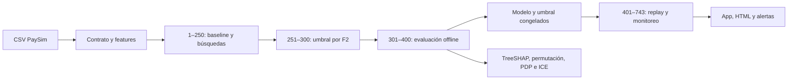

# Detección de fraude y monitoreo temporal

Proyecto final de Machine Learning Engineering III: clasificar `isFraud` en PaySim, comparar optimización temporal, explicar el modelo y monitorear producción histórica simulada. Proyecto independiente; la V2 de aprobación crediticia se conserva intacta.

**Estado técnico:** cuatro notebooks ejecutados, modelo y umbral congelados, interpretabilidad, replay completo, aplicación Streamlit y reportes HTML. Baseline, optimización, evaluación, explicaciones y monitoreo publicados y verificados en DagsHub. Modelo final registrado, versión 1, estado READY, etapa Production para el replay educativo. No hay tráfico real ni servicio desplegado.

## Flujo y división temporal



El dataset indicado por la consigna tiene 6.362.620 filas y 8.213 fraudes. Se conserva completo, sin SMOTE ni submuestreo para entrenar o evaluar. Solo las explicaciones y el reporte de distribuciones usan muestras explícitas. El límite 400/401 proviene de la consigna; los cortes internos son decisiones de validación.

| Bloque | Steps | Filas | Fraudes | Uso |
| --- | --- | ---: | ---: | --- |
| Desarrollo | 1–250 | 3.248.292 | 2.841 | Entrenamiento y tres folds temporales |
| Validación de umbral | 251–300 | 825.358 | 560 | Máximo F2, empate a mayor umbral |
| Prueba offline | 301–400 | 1.713.380 | 1.076 | Evaluación final independiente |
| Producción histórica | 401–743 | 575.590 | 3.736 | Replay sin ajustes |

Momento de detección: **después de registrar la transacción**, porque se utilizan saldos finales. No se acredita prevención antes de autorizarla. Se excluyen target, regla `isFlaggedFraud`, identificadores, row_id y step de los trece predictores. Ver [diccionario](docs/DATA_DICTIONARY.md) y [ficha del modelo](model-card.md).

## Reproducir

Usar Python 3.12 y ejecutar desde la raíz:

```powershell
python -m venv .venv
.\.venv\Scripts\python.exe -m pip install -r requirements-stage4.txt
Copy-Item .env.example .env
# Configurar PAYSIM_CSV con la ruta al CSV original y MLFLOW_BACKEND=local.
.\.venv\Scripts\python.exe -m src.fraud.prepare
.\.venv\Scripts\python.exe -m src.fraud.baseline
.\.venv\Scripts\python.exe -m src.fraud.optimize --trials 10 --threads 4
.\.venv\Scripts\python.exe -m src.fraud.candidate
.\.venv\Scripts\python.exe -m src.fraud.evaluate
.\.venv\Scripts\python.exe -m src.fraud.explain
.\.venv\Scripts\python.exe -m src.fraud.monitor
.\.venv\Scripts\python.exe -m streamlit run app.py
```

Los comandos reutilizan evidencias de hashes compatibles y no vuelven a seleccionar con test. Para una ejecución completamente nueva, utilizar otro checkout y producir sus propios artefactos; no mezclar resúmenes anteriores con otro modelo. Los tiempos y métricas pueden variar entre entornos. La ejecución original usa semilla 42 y cuatro threads; las versiones están fijadas en requirements y reportadas en `reports/environment-stage4.json`.

El CSV, particiones, modelos binarios y bases locales están ignorados por Git. [Origen de datos y reproducción](data/README.md). Las credenciales se configuran localmente en `.env`; nunca forman parte del repositorio. Para solo consultar la app basta con las evidencias incluidas y Streamlit: no necesita credenciales ni el CSV.

## Optimización y decisión

Dummy y árbol de profundidad 6 forman el baseline. XGBoost se optimiza con **Random Search y TPE de Optuna**, diez configuraciones por método, mismo espacio, semilla y tres folds cronológicos. Los primeros cuatro ensayos coincidentes se ejecutan realmente en cada método. No hay pruning ni early stopping que favorezcan presupuestos distintos. Ver [protocolo](docs/SEARCH_PROTOCOL.md).

| Método | Mejor AP temporal media | Minutos del objetivo |
| --- | ---: | ---: |
| Random Search | 0,997795 | 6,97 |
| TPE | 0,997233 | 8,99 |
| Árbol baseline | 0,994281 | Ver folds |

Se selecciona XGBoost de Random Search: 90 árboles, profundidad 3. Resultado limitado a esta semilla y presupuesto; no implica superioridad universal. El peso de clase se calcula solo con cada entrenamiento. El candidato se ajusta en 1–250; no se reentrena después de elegir el umbral **0,9741922617** en 251–300. Los scores no están calibrados.

## Resultados del modelo congelado

| Periodo | AP | Precisión | Recall | F2 | TP | FP | FN |
| --- | ---: | ---: | ---: | ---: | ---: | ---: | ---: |
| Offline 301–400 | 0,999269 | 98,5294 % | 99,6283 % | 0,994065 | 1.072 | 16 | 4 |
| Replay 401–743 | 0,999668 | 99,8119 % | 99,4379 % | 0,995125 | 3.715 | 7 | 21 |

En el test offline el umbral 0,5 produce F2 ligeramente mayor; se informa como diagnóstico y se mantiene el elegido previamente. Cambiarlo después de observar ese resultado invalidaría la independencia del test. Los resultados altos son plausibles por las relaciones contables del simulador y no garantizan desempeño real.

## Interpretabilidad

TreeSHAP nativo de XGBoost, global y ocho casos TP/FP/FN/TN, con aditividad y concordancia del score verificadas. Se explica una muestra uniforme offline de 20.000 filas con 16 fraudes. Principales variables: discrepancia del débito de origen, saldo final de origen y condición de comerciante. La permutación usa AP y tres repeticiones; PDP/ICE muestra respuesta del pipeline. Se declaran pocas etiquetas positivas, correlación, combinaciones potencialmente irreales y ausencia de interpretación causal. PaySim no permite certificar equidad demográfica.

## Monitoreo y respuesta

Siete ventanas de 50 steps, última parcial, con volumen, faltantes, ceros, score, desempeño, PSI, KS con corrección BH y ADWIN sobre errores ordenados. Referencia fija de drift: 50.000 filas uniformes de steps 301–400. PSI ≥ 0,2 o KS con efecto ≥ 0,1 y rechazo BH al 5 % genera investigación. Con al menos 30 fraudes, recall < 0,95 o precisión < 0,90 alerta de desempeño. La política se guarda antes de abrir producción.

La última ventana presenta drift en siete columnas y mayor prevalencia. No se cruzan los límites supervisados; ADWIN no emite señales observadas. El escenario controlado separado invierte el 15 % de etiquetas de la segunda mitad y detecta el cambio tras 76 filas. No se presenta esa señal sintética como hallazgo observado. Cambio de distribución o de error no prueba por sí solo concept drift.

Las etiquetas son históricas e inmediatamente accesibles para esta simulación; en operación real hay retrasos. No se reentrena automáticamente. Ante alertas: verificar calidad/etiquetas, segmentar errores, confirmar persistencia y evaluar un challenger temporalmente antes de promoción humana y rollback. La latencia medida excluye I/O e ingeniería; no es un SLA de API.

## Notebooks, app y reportes

| Entrega | Notebook | HTML ejecutado |
| --- | --- | --- |
| Datos y features | [01](notebooks/01_preprocesamiento.ipynb) | [Preprocesamiento](reports/01_preprocesamiento.html) |
| Baseline, búsquedas y test | [02](notebooks/02_entrenamiento.ipynb) | [Entrenamiento](reports/evaluation/02_entrenamiento_evaluacion.html) |
| Interpretabilidad | [03](notebooks/03_interpretabilidad.ipynb) | [Explicaciones](reports/interpretability/03_interpretabilidad.html) |
| Monitoreo | [04](notebooks/04_monitoreo.ipynb) | [Reporte final](reports/monitoring/04_monitoreo.html) |

[Reporte Evidently](reports/monitoring/evidently_drift.html) · [app Streamlit](app.py) · [métricas por ventana](reports/monitoring/windows.csv) · [alertas](reports/monitoring/alert_policy.json). GitHub muestra HTML como código: descargar el archivo y abrirlo en el navegador, o usar la descarga desde la app.

## MLflow y DagsHub

El host de tracking reutiliza la conexión de V2, con experimentos de fraude separados. No se modifican modelos ni experimentos hipotecarios.

- [Baseline](https://dagshub.com/jorgesialer/Proyecto-mle-riesgo.mlflow/#/experiments/1/runs/00303d2bd7304de6868196341eff688d).
- [Random Search](https://dagshub.com/jorgesialer/Proyecto-mle-riesgo.mlflow/#/experiments/2/runs/ee7dfc831ece4bafbe337ac26e16f882).
- [TPE](https://dagshub.com/jorgesialer/Proyecto-mle-riesgo.mlflow/#/experiments/2/runs/7373d47b615b4ae2a8e037f8238a6653).
- [Candidato antes del umbral](https://dagshub.com/jorgesialer/Proyecto-mle-riesgo.mlflow/#/experiments/2/runs/c8303ef974ee4a879e4fa6a9594e8c5a).

- [Modelo final y evaluación offline](https://dagshub.com/jorgesialer/Proyecto-mle-riesgo.mlflow/#/experiments/3/runs/5cc382370d9f41eda4e300af13eb1ba1).
- [Interpretabilidad](https://dagshub.com/jorgesialer/Proyecto-mle-riesgo.mlflow/#/experiments/3/runs/095cbbaffc5f41c9909c437b98808c33).
- [Monitoreo](https://dagshub.com/jorgesialer/Proyecto-mle-riesgo.mlflow/#/experiments/3/runs/8718daf1d9734bd68975ea8df3800641).

Modelo registrado: `fraud-paysim-posttransaction`, versión `1`, etapa `Production` (simulación educativa, sin servicio en vivo). URI reproducible: `runs:/5cc382370d9f41eda4e300af13eb1ba1/model`.

Veinte trials, métricas y artefacto del candidato verificados remotamente. La evidencia final está en `reports/final_remote_tracking.json`: hashes del modelo descargado, paridad exacta de scores/decisiones en 1.000 filas, métricas remotas y registro verificados. Los scripts `publish_baseline`, `publish_optimization` y `publish_final` exportan modelos y evidencias, no el dataset completo. Publicar requiere credenciales y autorización del propietario.

## Validación, rúbrica y entrega

```powershell
python -m unittest discover -s tests -v
```

22 pruebas: contrato, exclusión de target/metadata, causalidad temporal, tratamiento del ratio, encoder, pesos, métricas, selección exhaustiva del umbral, modelo congelado, PSI/BH y sensibilidad de ADWIN. Los cuatro notebooks se ejecutan sin errores. La prueba de la app comprueba inicio y selección de ventana. [Plan y rúbrica](docs/PROJECT_PLAN.md) · [conclusiones](docs/CONCLUSIONS.md).

El material revisado para definir el alcance fue la consigna PDF y los notebooks/materiales de los diez ZIP. No se afirma haber transcrito o revisado íntegramente las diez grabaciones MP4. El criterio de la consigna es contenido de referencia, no autorización para enviar correos o modificar cuentas.

GitHub: [repositorio independiente](https://github.com/jorgesialer/Proyecto-mle-fraude), ramas [main](https://github.com/jorgesialer/Proyecto-mle-fraude/tree/main) y [development](https://github.com/jorgesialer/Proyecto-mle-fraude/tree/development). [PR #1 integrada](https://github.com/jorgesialer/Proyecto-mle-fraude/pull/1). Entrega versionada: [1.0.0](https://github.com/jorgesialer/Proyecto-mle-fraude/releases/tag/1.0.0). La entrega por correo requiere que el alumno confirme destinatario y envíe o autorice el mensaje; aquí se prepara el proyecto y sus enlaces.
