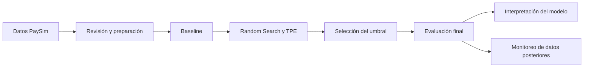
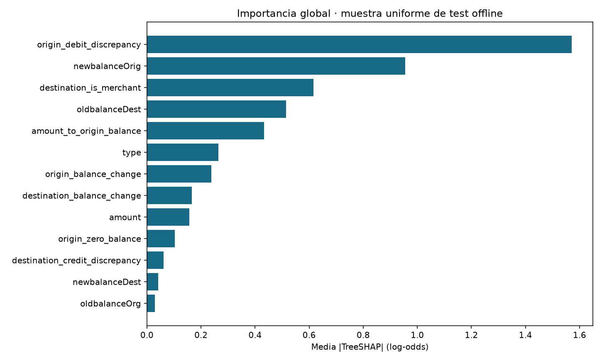
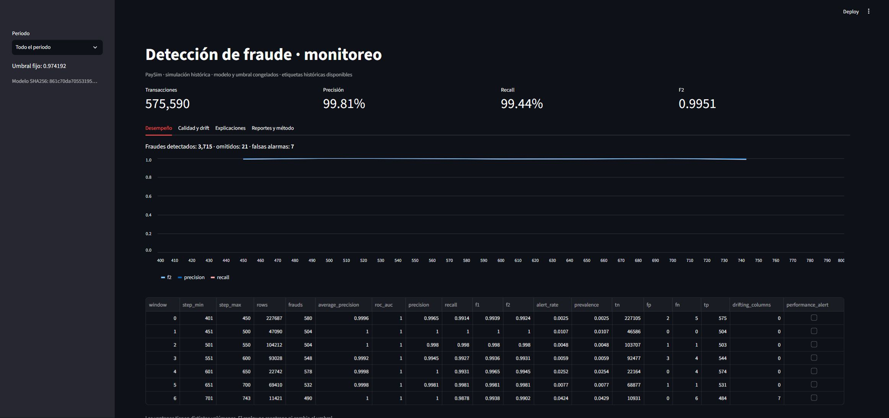
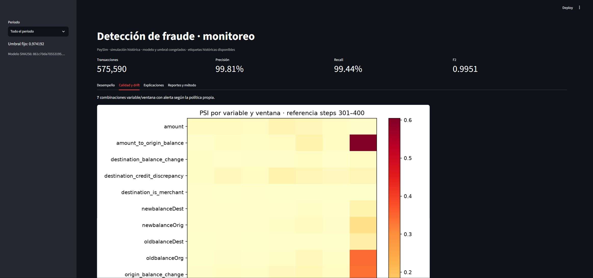
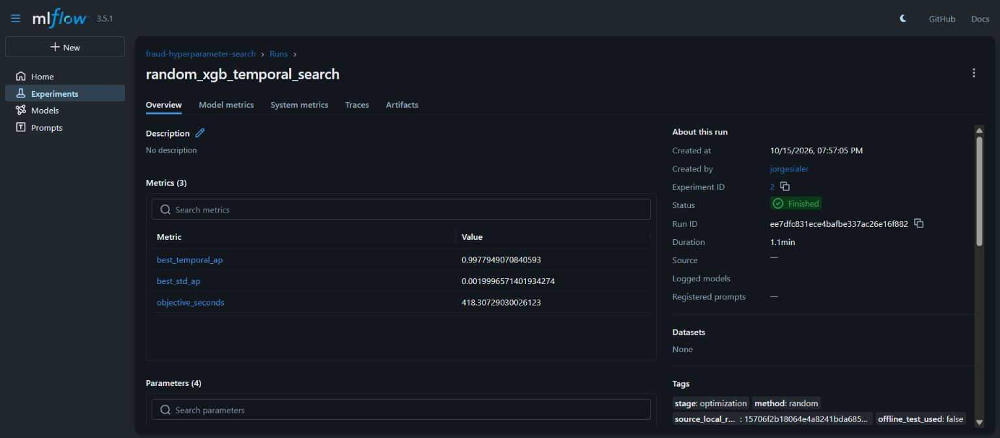
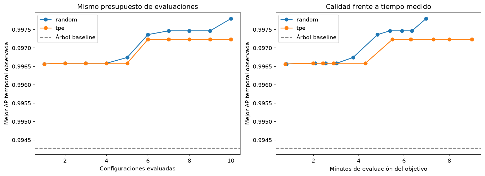
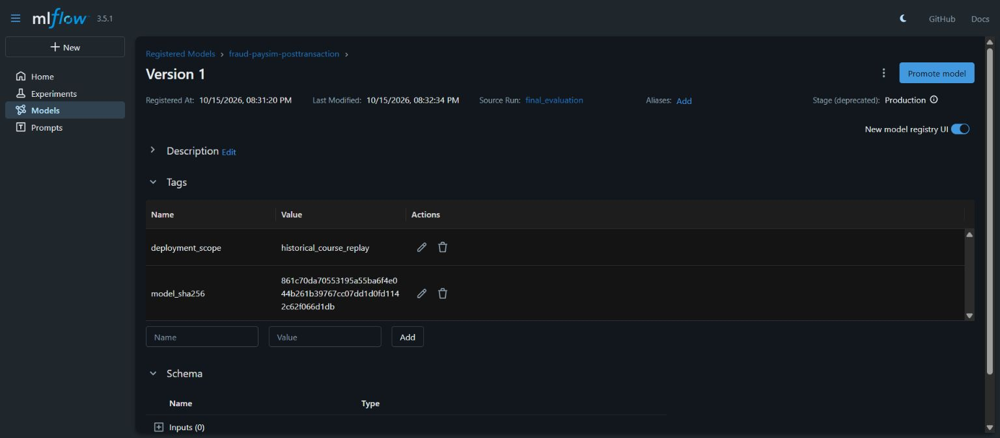
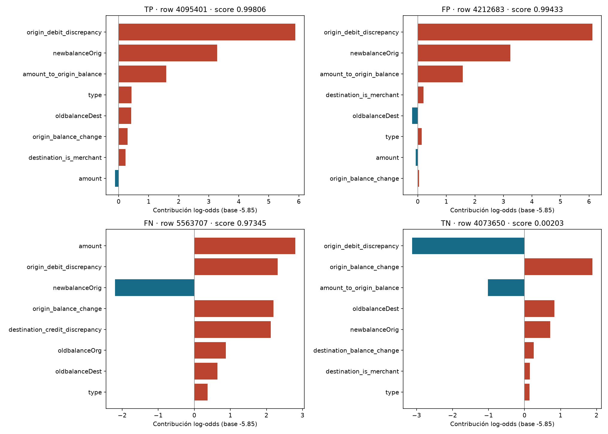

# Detección de fraude en transacciones con PaySim

Aplicación de clasificación y monitoreo de fraude financiero con XGBoost, MLflow y Streamlit. Proyecto del curso Machine Learning Engineering III.

[Entrega 1.0.0](https://github.com/jorgesialer/Proyecto-mle-fraude/releases/tag/1.0.0) · [Instalación](#instalación-y-uso) · [Evidencias](#evidencias) · [Conclusiones](#conclusiones)

Esta aplicación identifica transacciones fraudulentas en PaySim y monitorea el desempeño del modelo en periodos posteriores. El proyecto integra preparación de datos, validación temporal, optimización con Random Search y TPE, interpretación de predicciones y un panel de monitoreo.

## Datos y problema

El archivo contiene **6.362.620 transacciones**, de las cuales **8.213 son fraudes**. Es un problema de clasificación con un fuerte desbalance de clases. El dataset está disponible en [Kaggle](https://www.kaggle.com/datasets/charlesbeauchamp/ps-20174392719-1491204439457-logcsv); el [diccionario de datos](#diccionario-de-datos) describe las columnas originales y las variables derivadas.

El modelo utiliza saldos anteriores y posteriores a la operación para analizar transacciones registradas. El pipeline excluye `isFlaggedFraud`, los identificadores y la etiqueta de los predictores.

## Arquitectura del proyecto



El proyecto aplica el corte temporal de la consigna: referencia hasta el step 400 y producción desde 401. El primer bloque contiene periodos independientes para seleccionar el modelo, ajustar el umbral y evaluar el resultado final.

| Uso | Steps | Transacciones | Fraudes |
| --- | --- | ---: | ---: |
| Entrenamiento y búsqueda | 1–250 | 3.248.292 | 2.841 |
| Ajuste del umbral | 251–300 | 825.358 | 560 |
| Evaluación offline | 301–400 | 1.713.380 | 1.076 |
| Monitoreo de producción simulada | 401–743 | 575.590 | 3.736 |

### Entrenamiento y optimización

El entrenamiento compara un predictor de referencia (`DummyClassifier`) con un árbol de decisión y optimiza XGBoost mediante **Random Search** y **TPE** en Optuna. Cada método evalúa diez configuraciones en tres ventanas temporales: 60 ajustes de XGBoost.

| Método | Mejor AP media de validación | Tiempo de búsqueda |
| --- | ---: | ---: |
| Árbol de referencia | 0,994281 | Ver notebook 02 |
| Random Search | 0,997795 | 6,97 minutos |
| TPE | 0,997233 | 8,99 minutos |

Random Search obtiene la mayor AP media de esta comparación. La selección final utiliza XGBoost con 90 árboles y profundidad 3. La validación maximiza F2 para fijar el umbral **0,974192**. Esta métrica prioriza la detección de fraudes y considera las falsas alarmas. El modelo mantiene el mismo umbral durante la evaluación y el monitoreo.

Los detalles del espacio de búsqueda y de la validación están en el [protocolo de optimización](#detalles-de-la-optimización) y el [protocolo de evaluación](#selección-del-umbral). El resultado corresponde a esta semilla y a este presupuesto; no permite concluir que Random Search siempre sea mejor que TPE.

### Resultados

| Periodo | AP | Precisión | Recall | F2 | Fraudes detectados | Fraudes omitidos | Falsas alarmas |
| --- | ---: | ---: | ---: | ---: | ---: | ---: | ---: |
| Evaluación offline | 0,999269 | 98,53 % | 99,63 % | 0,994065 | 1.072 | 4 | 16 |
| Producción simulada | 0,999668 | 99,81 % | 99,44 % | 0,995125 | 3.715 | 21 | 7 |

El umbral 0,5 obtiene F2 ligeramente mayor en la prueba offline. El proyecto conserva el umbral elegido en validación para mantener la independencia de esa prueba. Los scores del modelo no representan probabilidades calibradas.


### Interpretación

El módulo de interpretación combina SHAP global y local, importancia por permutación y curvas PDP/ICE. La discrepancia del débito de origen y el saldo final de origen concentran las mayores contribuciones. El análisis incluye fraudes detectados, operaciones legítimas y errores del modelo.



Las explicaciones utilizan una muestra uniforme de 20.000 transacciones de prueba, que contiene 16 fraudes. Como hay variables relacionadas entre sí, la permutación y las curvas deben interpretarse con cuidado. Los resultados describen el comportamiento del modelo en PaySim; no demuestran causalidad ni garantizan el mismo desempeño con datos bancarios reales.

### Monitoreo

El panel muestra desempeño, faltantes, cambios de distribución y explicaciones. El monitoreo agrupa las transacciones en ventanas de 50 steps y compara sus distribuciones con una muestra fija de referencia. PSI y KS con corrección BH detectan cambios de distribución; ADWIN analiza la secuencia de errores.

La última ventana presentó alertas de distribución en siete variables. Las métricas no cruzaron los límites de desempeño establecidos y ADWIN no detectó cambios en los errores observados. Una prueba independiente con etiquetas alteradas comprueba la respuesta del detector ante un cambio conocido. Ese escenario no participa en las métricas anteriores.



Las etiquetas ya están disponibles en el dataset, por eso se puede evaluar cada ventana. En una operación real habría que esperar la confirmación del fraude. Las alertas sirven para investigar; no activan un reentrenamiento automático.

## Estructura y control de versiones

```text
Proyecto-mle-fraude/
├── README.md           # Documentación completa
├── app.py              # Panel de monitoreo
├── requirements.txt    # Dependencias
├── notebooks/          # Los cuatro notebooks solicitados
├── data/               # Muestra CSV y ubicación de datos locales
├── src/fraud/          # Preparación, modelo, evaluación y monitoreo
├── tests/              # Un archivo con las pruebas agrupadas
├── reports/            # Cinco HTML y un JSON para la aplicación
└── evidencias/         # Capturas y gráficos utilizados en la entrega
```

El README concentra las conclusiones, la ficha del modelo, el diccionario y las instrucciones. `reports/resultados.json` contiene los resúmenes y las tablas que necesita la aplicación. Los registros por fold, intentos, predicciones y comprobaciones técnicas permanecen en `artifacts/run_reports/`, fuera de Git.

Los módulos de `src/fraud` separan responsabilidades del software. `schema`, `modeling`, `boosting` y `decision` conservan sus nombres porque el modelo serializado los utiliza al cargar sus transformadores y su regla de decisión. El archivo `tests/test_project.py` agrupa las comprobaciones por componente.

Las ramas `main` y `development` conservan el historial. La [PR inicial](https://github.com/jorgesialer/Proyecto-mle-fraude/pull/1) integra el análisis completo. La versión de entrega es **1.0.0**; la organización documental no representa un modelo distinto.

## Instalación y uso

1. Clona el repositorio y entra en su carpeta.
2. Utiliza Python 3.12.
3. Crea el entorno, instala las dependencias y ejecuta el panel:


```powershell
git clone https://github.com/jorgesialer/Proyecto-mle-fraude.git
cd Proyecto-mle-fraude
python -m venv .venv
.\.venv\Scripts\python.exe -m pip install -r requirements.txt
.\.venv\Scripts\python.exe -m streamlit run app.py
```

Abre la dirección local que indica Streamlit. Selecciona un periodo y consulta las pestañas de desempeño, drift, explicaciones y reportes. El panel utiliza los resultados incluidos y funciona sin entrenamiento adicional ni credenciales. Para ejecutar el análisis completo, sigue la [guía de reproducción](#ejecuta-el-análisis-completo).

## Notebooks y reportes

| Tema | Notebook | Reporte HTML |
| --- | --- | --- |
| Preparación | [01](notebooks/01_preprocesamiento.ipynb) | [Ver reporte](reports/01_preprocesamiento.html) |
| Entrenamiento y evaluación | [02](notebooks/02_entrenamiento.ipynb) | [Ver reporte](reports/02_entrenamiento.html) |
| Interpretación | [03](notebooks/03_interpretabilidad.ipynb) | [Ver reporte](reports/03_interpretabilidad.html) |
| Monitoreo | [04](notebooks/04_monitoreo.ipynb) | [Ver reporte](reports/04_monitoreo.html) |

El [reporte de Evidently](reports/evidently_drift.html) complementa el análisis de distribución. Descarga los archivos HTML y ábrelos en el navegador. Las [capturas de evidencia](#evidencias) permiten revisar los puntos principales directamente desde GitHub.

## Experimentos y modelo

Los parámetros, métricas y modelos están registrados en MLflow a través de DagsHub:

- [Baseline](https://dagshub.com/jorgesialer/Proyecto-mle-riesgo.mlflow/#/experiments/1/runs/00303d2bd7304de6868196341eff688d).
- [Random Search](https://dagshub.com/jorgesialer/Proyecto-mle-riesgo.mlflow/#/experiments/2/runs/ee7dfc831ece4bafbe337ac26e16f882) y [TPE](https://dagshub.com/jorgesialer/Proyecto-mle-riesgo.mlflow/#/experiments/2/runs/7373d47b615b4ae2a8e037f8238a6653).
- [Modelo final y evaluación](https://dagshub.com/jorgesialer/Proyecto-mle-riesgo.mlflow/#/experiments/3/runs/5cc382370d9f41eda4e300af13eb1ba1).
- [Interpretación](https://dagshub.com/jorgesialer/Proyecto-mle-riesgo.mlflow/#/experiments/3/runs/095cbbaffc5f41c9909c437b98808c33) y [monitoreo](https://dagshub.com/jorgesialer/Proyecto-mle-riesgo.mlflow/#/experiments/3/runs/8718daf1d9734bd68975ea8df3800641).

El modelo registrado es `fraud-paysim-posttransaction`, versión 1. La etapa Production identifica el modelo usado en la simulación; no significa que exista un servicio bancario desplegado. La [ficha del modelo](#ficha-del-modelo) resume su uso y sus limitaciones.

## Conclusiones

XGBoost mejoró el resultado del árbol de referencia y mantuvo una buena detección de fraudes en los datos posteriores. La interpretación mostró que depende bastante de las relaciones entre los saldos. Esto ayuda a entender sus resultados altos, pero también limita lo que se puede concluir fuera del simulador.

El monitoreo permitió identificar una ventana con cambios en las variables, aunque el desempeño siguió por encima de los límites establecidos. El flujo de respuesta prioriza la revisión de los datos y los errores antes de evaluar un nuevo entrenamiento.

La validación incluye 22 pruebas del código y una comprobación del filtro de periodos de la aplicación. Los cuatro notebooks contienen sus resultados de ejecución. La [estrategia de Git y los entregables](#estructura-y-control-de-versiones) relacionan el contenido con la consigna.


## Ficha del modelo

| Campo | Especificación |
| --- | --- |
| Objetivo | Clasificación binaria de `isFraud` en PaySim |
| Algoritmo | XGBoost, 90 árboles y profundidad 3 |
| Entrada | Trece predictores preparados; tipo, saldos, monto e indicadores derivados |
| Entrenamiento | Steps 1–250, sin validación ni test |
| Decisión | Score ≥ 0,9741922617; scores sin calibración de probabilidades |
| Momento de uso | Después de registrar la transacción |
| Registro | `fraud-paysim-posttransaction`, versión 1 en MLflow |
| Límites | Datos simulados, variables correlacionadas y ausencia de atributos para evaluar equidad demográfica |

El [modelo final en DagsHub](https://dagshub.com/jorgesialer/Proyecto-mle-riesgo.mlflow/#/experiments/3/runs/5cc382370d9f41eda4e300af13eb1ba1) conserva el artefacto y sus métricas. Los resultados completos aparecen en la sección Resultados y en `reports/resultados.json`.

## Ejecuta el análisis completo

1. Instala las dependencias con los comandos de la sección Instalación y uso.
2. Descarga el CSV completo desde [Kaggle](https://www.kaggle.com/datasets/charlesbeauchamp/ps-20174392719-1491204439457-logcsv).
3. Guarda el archivo en `data/raw/` o configura su ruta con `PAYSIM_CSV`.
4. Copia `.env.example` como `.env` y establece `MLFLOW_BACKEND=local`.
5. Ejecuta los módulos en este orden desde la raíz:

```powershell
Copy-Item .env.example .env
.\.venv\Scripts\python.exe -m src.fraud.prepare
.\.venv\Scripts\python.exe -m src.fraud.baseline
.\.venv\Scripts\python.exe -m src.fraud.optimize --trials 10 --threads 4
.\.venv\Scripts\python.exe -m src.fraud.candidate
.\.venv\Scripts\python.exe -m src.fraud.evaluate
.\.venv\Scripts\python.exe -m src.fraud.explain
.\.venv\Scripts\python.exe -m src.fraud.monitor
```

El monitoreo actualiza `reports/resultados.json` y los recursos del panel. Los datos preparados, el modelo y los registros detallados permanecen en las carpetas locales ignoradas por Git. Mantén juntos los artefactos y registros de cada ejecución; no mezcles modelos y resúmenes de ejecuciones distintas.

Abre los notebooks en orden y selecciona el kernel del entorno instalado. Después de ejecutar los notebooks, exporta sus salidas registradas a HTML:

```powershell
.\.venv\Scripts\python.exe -m src.fraud.reporting --html
```

Ejecuta las comprobaciones del código:

```powershell
.\.venv\Scripts\python.exe -m unittest discover -s tests -v
```

`data/sample_illustrative.csv` contiene las primeras 50 filas de cada partición. Permite consultar el esquema, pero no representa la distribución del dataset ni interviene en el entrenamiento. El CSV completo pesa aproximadamente 494 MB.

## Diccionario de datos

### Columnas originales

Dataset PaySim entregado por el profesor, archivo `PS_20174392719_1491204439457_log.csv`.

| Columna | Significado | Uso |
| --- | --- | --- |
| `step` | Hora de la simulación | Separación temporal y monitoreo; excluida de predictores |
| `type` | CASH_IN, CASH_OUT, DEBIT, PAYMENT, TRANSFER | Predictor categórico |
| `amount` | Monto de la transacción en moneda local simulada | Predictor numérico |
| `nameOrig` | Identificador del originador | Excluido para evitar memorización |
| `oldbalanceOrg` | Saldo inicial del originador; se conserva la grafía del CSV | Predictor numérico |
| `newbalanceOrig` | Saldo final del originador | Predictor posterior a transacción |
| `nameDest` | Identificador del destinatario | Solo se extrae el prefijo M de merchant |
| `oldbalanceDest` | Saldo inicial del destinatario | Predictor; ceros de merchant no significan saldo conocido |
| `newbalanceDest` | Saldo final del destinatario | Predictor posterior a transacción; misma limitación |
| `isFraud` | 1 si la transacción está etiquetada como fraude | Target; nunca predictor |
| `isFlaggedFraud` | Alerta de la regla existente del simulador | Excluida de predictores; futura referencia comparativa |

### Variables derivadas

| Variable | Definición | Tratamiento |
| --- | --- | --- |
| `origin_balance_change` | oldbalanceOrg − newbalanceOrig | Cambio de saldo, sin interpretación causal |
| `destination_balance_change` | newbalanceDest − oldbalanceDest | Cambio observado del destinatario |
| `amount_to_origin_balance` | amount / oldbalanceOrg | NaN si el denominador es cero; no usar infinito |
| `origin_zero_balance` | oldbalanceOrg == 0 | Indicador explícito |
| `destination_is_merchant` | nameDest empieza con M | Distingue saldos no informados del destinatario |
| `origin_debit_discrepancy` | origin_balance_change − amount | Interpretar por tipo: CASH_IN aumenta el saldo |
| `destination_credit_discrepancy` | destination_balance_change − amount | No asumir que un merchant informa sus saldos |

El ratio genera NaN cuando el saldo de origen es cero. El pipeline del baseline ajusta la imputación exclusivamente con los datos de entrenamiento de cada fold. XGBoost conserva esos NaN y aplica su tratamiento nativo de valores ausentes. El encoder categórico utiliza las cinco categorías del contrato y no aprende estadísticas del conjunto completo.

`row_id` conserva la posición original, de base cero, para trazabilidad y pruebas de unicidad. Cada Parquet contiene predictores, `row_id`, `step` y target. El pipeline excluye los tres últimos de la matriz de entrada al modelo.


## Detalles de la optimización


### Comparación congelada antes de evaluar

El módulo de optimización compara Random Search y TPE sobre XGBoost con histogramas CPU y un motor de evaluación común. Random Search utiliza `optuna.samplers.RandomSampler`. TPE utiliza `TPESampler`, comienza con cuatro trials aleatorios y continúa con sugerencias guiadas por los resultados anteriores.

Presupuesto: diez configuraciones por método y tres folds por configuración, sesenta ajustes en total. Sin pruning, early stopping ni selección basada en producción. Misma semilla 42, mismo espacio y límites, cuatro hilos y población completa. Los primeros cuatro trials pueden coincidir porque ambos samplers parten de la misma semilla; se ejecutan realmente para ambos, sin reutilizar resultados ni conceder tiempo gratuito a un método.

Métrica objetivo: media no ponderada de Average Precision entre las tres ventanas cronológicas de desarrollo (validación 101–150, 151–200 y 201–250). La desviación entre ventanas se reporta, sin interpretarla como intervalo de confianza. Los steps 251 en adelante no se abren.

### Transformación y desbalance

El encoder representa el tipo mediante one-hot con las cinco categorías del contrato y convierte las columnas numéricas a float32 para reducir memoria. La transformación conserva los NaN del ratio de saldo cero y no aprende estadísticas: XGBoost aplica su tratamiento nativo de valores ausentes. El baseline utiliza imputación. Random Search y TPE comparten exactamente el mismo encoder y los mismos datos.

Cada fold calcula `scale_pos_weight = sqrt(n_negativos / n_positivos)` exclusivamente con sus etiquetas de entrenamiento. La validación conserva todas sus filas y no participa en el cálculo de pesos. Esta política permanece fija durante la comparación. Los scores no constituyen probabilidades calibradas.

### Espacio de búsqueda

| Parámetro | Dominio |
| --- | --- |
| n_estimators | 60, 90, 120, 150, 180 |
| max_depth | Enteros 2–6 |
| learning_rate | 0,03–0,2, log-uniforme |
| min_child_weight | 1–20, log-uniforme |
| subsample | 0,8–1, uniforme |
| colsample_bytree | 0,8–1, uniforme |
| reg_lambda | 0,1–30, log-uniforme |

Fijos: objective=binary:logistic, tree_method=hist, max_bin=128 y random_state=42. Se miden duración por fold y por trial; mismo número de evaluaciones no implica idéntico tiempo. Los gráficos comparan calidad frente a configuraciones y tiempo medido del objetivo.

### Evidencia y límites

Cada trial guarda parámetros, cortes, pesos, métricas por fold, duración y run MLflow local. Los estudios SQLite y el estado del sampler se conservan en artifacts para evitar repetir búsquedas completadas. No se registra una mejora hasta terminar la comparación.

Se selecciona por AP media temporal entre el mejor XGBoost y el árbol baseline; si la mejora no supera 1e-6 se conserva el baseline. Las mejores métricas de CV tras buscar múltiples configuraciones son optimistas para estimar generalización: la evaluación final seguirá en el bloque offline reservado, después de elegir el umbral en su propio bloque.

Esta es una comparación acotada con una semilla. No demuestra superioridad universal de un optimizador, ni que se haya encontrado un óptimo global. La simulación y el uso de saldos finales limitan la interpretación de resultados altos.

Referencias: notebooks de las sesiones 3–4; [Optuna TPE](https://optuna.readthedocs.io/en/stable/reference/samplers/generated/optuna.samplers.TPESampler.html); [API XGBoost](https://xgboost.readthedocs.io/en/stable/python/python_api.html#xgboost.XGBClassifier).

## Selección del umbral


La validación temporal selecciona el candidato en steps 1–250. El ajuste final utiliza ese mismo periodo y fija sus parámetros antes de consultar los bloques posteriores.

La política de decisión maximiza F2 en los steps 251–300. Ante un empate numérico de F2 a 1e-12, el selector elige el umbral más alto. La regla es `score >= threshold`. F2 prioriza recall; no representa costos monetarios observados. Los scores ponderados no constituyen probabilidades calibradas.

El módulo de evaluación guarda la política en `artifacts/run_reports/evaluation/decision_policy.json`, junto con los hashes del modelo y los datos, antes de abrir el test 301–400. La evaluación conserva el modelo y el umbral. Las métricas con umbral 0,5 funcionan como diagnóstico de referencia y no intervienen en una nueva selección.

La inferencia procesa lotes y guarda predicciones y manifiestos de hash en `artifacts`. Los gráficos reutilizan esas predicciones. El programa rechaza combinaciones incompatibles de datos y modelos; las ejecuciones posteriores del CLI conservan el resultado existente sin repetir búsquedas sobre el test.

El artefacto de decisión combina el pipeline elegido y el umbral fijo. La comprobación de recarga compara sus predicciones con las del modelo original. `predict` aplica el umbral y `predict_proba` conserva los scores. El entrenamiento excluye validación y test; producción desde 401 permanece fuera de esta etapa.

Referencia: [precision_recall_curve de scikit-learn](https://scikit-learn.org/stable/modules/generated/sklearn.metrics.precision_recall_curve.html). Su último punto no tiene umbral asociado y se excluye de la optimización.


## Evidencias

Las capturas muestran páginas reales de la aplicación y de MLflow. Los gráficos analíticos provienen de los resultados de esta ejecución. El panel general aparece en la sección Monitoreo.

### Calidad y drift




La última ventana concentra siete alertas de distribución. Estas alertas orientan la investigación; por sí solas no prueban un cambio en la relación entre variables y fraude.

### Optimización en MLflow





El campo `objective_seconds` registra 418,31 segundos para Random Search. El campo Duration del run remoto corresponde a la publicación de los resultados posterior al entrenamiento local.

### Evaluación y modelo registrado




### Explicaciones de aciertos y errores


