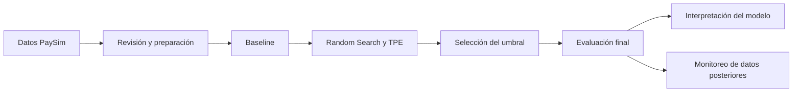

# Detección de fraude en transacciones con PaySim

Proyecto final del curso Machine Learning Engineering III.

[Entrega actual: 1.0.1](https://github.com/jorgesialer/Proyecto-mle-fraude/releases/tag/1.0.1) · [Capturas de evidencia](docs/EVIDENCIAS.md)

El objetivo es identificar transacciones fraudulentas y revisar si el modelo mantiene su desempeño cuando recibe datos de periodos posteriores. Para ello trabajé con PaySim, comparé dos métodos de optimización, interpreté el modelo elegido y preparé un panel de monitoreo.

## Datos y problema

El archivo contiene **6.362.620 transacciones**, de las cuales **8.213 son fraudes**. Es un problema de clasificación con un fuerte desbalance de clases. El dataset está disponible en [Kaggle](https://www.kaggle.com/datasets/charlesbeauchamp/ps-20174392719-1491204439457-logcsv); el [diccionario de datos](docs/DATA_DICTIONARY.md) describe las columnas y las variables que preparé.

Usé los saldos anteriores y posteriores a la operación, por lo que el modelo analiza transacciones que ya fueron registradas. No utilicé `isFlaggedFraud`, los identificadores ni la etiqueta como predictores.

## Cómo desarrollé el proyecto



Respeté el corte temporal indicado en la consigna: referencia hasta el step 400 y producción desde 401. Dentro del primer bloque separé los datos para elegir el modelo, ajustar el umbral y evaluar el resultado final.

| Uso | Steps | Transacciones | Fraudes |
| --- | --- | ---: | ---: |
| Entrenamiento y búsqueda | 1–250 | 3.248.292 | 2.841 |
| Ajuste del umbral | 251–300 | 825.358 | 560 |
| Evaluación offline | 301–400 | 1.713.380 | 1.076 |
| Monitoreo de producción simulada | 401–743 | 575.590 | 3.736 |

### Entrenamiento y optimización

Primero comparé un predictor simple (`DummyClassifier`) con un árbol de decisión. Después ajusté XGBoost con **Random Search** y **TPE**, implementados en Optuna. Probé diez configuraciones por método y tres ventanas temporales por configuración: 60 entrenamientos en total.

| Método | Mejor AP media de validación | Tiempo de búsqueda |
| --- | ---: | ---: |
| Árbol de referencia | 0,994281 | Ver notebook 02 |
| Random Search | 0,997795 | 6,97 minutos |
| TPE | 0,997233 | 8,99 minutos |

En esta comparación, Random Search obtuvo el mejor resultado. Elegí un XGBoost de 90 árboles y profundidad 3. Luego seleccioné el umbral **0,974192** con F2 en su bloque de validación. F2 da más importancia a detectar los fraudes, aunque también considera las falsas alarmas. Conservé ese umbral durante la evaluación y el monitoreo.

Los detalles del espacio de búsqueda y de la validación están en el [protocolo de optimización](docs/SEARCH_PROTOCOL.md) y el [protocolo de evaluación](docs/EVALUATION_PROTOCOL.md). El resultado corresponde a esta semilla y a este presupuesto; no permite concluir que Random Search siempre sea mejor que TPE.

### Resultados

| Periodo | AP | Precisión | Recall | F2 | Fraudes detectados | Fraudes omitidos | Falsas alarmas |
| --- | ---: | ---: | ---: | ---: | ---: | ---: | ---: |
| Evaluación offline | 0,999269 | 98,53 % | 99,63 % | 0,994065 | 1.072 | 4 | 16 |
| Producción simulada | 0,999668 | 99,81 % | 99,44 % | 0,995125 | 3.715 | 21 | 7 |

Con el umbral 0,5, F2 resulta ligeramente mayor en la prueba offline. Mantuve el umbral que había elegido antes para no usar el resultado de la prueba como una nueva decisión de ajuste. Los valores de salida del modelo no están calibrados como probabilidades.


### Interpretación

Usé SHAP global y local, importancia por permutación y curvas PDP/ICE. La discrepancia del débito de origen y el saldo final de origen fueron las variables más influyentes. También revisé ejemplos de fraudes detectados, operaciones legítimas y errores del modelo.


Las explicaciones se calcularon con una muestra uniforme de 20.000 transacciones de prueba, que contiene 16 fraudes. Como hay variables relacionadas entre sí, la permutación y las curvas deben interpretarse con cuidado. Los resultados describen el comportamiento del modelo en PaySim; no demuestran causalidad ni garantizan el mismo desempeño con datos bancarios reales.

### Monitoreo

El panel muestra el desempeño, los faltantes, los cambios de distribución y las explicaciones. Usé ventanas de 50 steps y comparé las distribuciones con una muestra fija del periodo de referencia. Para detectar cambios utilicé PSI, KS con corrección BH y ADWIN sobre los errores.

La última ventana presentó alertas de distribución en siete variables. Las métricas no cruzaron los límites de desempeño establecidos y ADWIN no detectó cambios en los errores observados. Además hice una prueba separada con etiquetas alteradas para comprobar que el detector respondiera a un cambio conocido; esos datos no forman parte de las métricas anteriores.


Las etiquetas ya están disponibles en el dataset, por eso se puede evaluar cada ventana. En una operación real habría que esperar la confirmación del fraude. Las alertas sirven para investigar; no activan un reentrenamiento automático.

## Archivos para revisar

| Carpeta o archivo | Contenido |
| --- | --- |
| `notebooks/` | Los cuatro notebooks solicitados: datos, entrenamiento, interpretación y monitoreo |
| `data/` | Una muestra del CSV e indicaciones para obtener el dataset completo |
| `app.py` | Aplicación de monitoreo en Streamlit |
| `src/` | Código que utilizan los notebooks para preparar, entrenar y evaluar |
| `reports/` | Resultados, gráficos y reportes HTML |
| `docs/` | Diccionario, métodos, instrucciones y capturas de evidencia |
| `tests/` | Comprobaciones del código |
| `requirements.txt` | Librerías necesarias para ejecutar el proyecto |

El código auxiliar evita repetir las mismas funciones en todos los notebooks. Los archivos grandes de datos, modelos y MLflow que se generan en la computadora no se suben a GitHub.

## Cómo abrir el panel

Desde la raíz del proyecto, con Python 3.12:

```powershell
python -m venv .venv
.\.venv\Scripts\python.exe -m pip install -r requirements.txt
.\.venv\Scripts\python.exe -m streamlit run app.py
```

El panel funciona en local y usa los reportes incluidos. No hace falta volver a entrenar ni configurar credenciales para consultarlo. Para ejecutar todo el análisis desde cero, seguir la [guía de reproducción](docs/REPRODUCTION.md).

## Notebooks y reportes

| Tema | Notebook | Reporte HTML |
| --- | --- | --- |
| Preparación | [01](notebooks/01_preprocesamiento.ipynb) | [Ver reporte](reports/01_preprocesamiento.html) |
| Entrenamiento y evaluación | [02](notebooks/02_entrenamiento.ipynb) | [Ver reporte](reports/evaluation/02_entrenamiento_evaluacion.html) |
| Interpretación | [03](notebooks/03_interpretabilidad.ipynb) | [Ver reporte](reports/interpretability/03_interpretabilidad.html) |
| Monitoreo | [04](notebooks/04_monitoreo.ipynb) | [Ver reporte](reports/monitoring/04_monitoreo.html) |

También se incluye el [reporte de Evidently](reports/monitoring/evidently_drift.html). Para ver los HTML, hay que descargarlos y abrirlos en el navegador. Las [capturas de evidencia](docs/EVIDENCIAS.md) permiten revisar los puntos principales directamente desde GitHub.

## Experimentos y modelo

Los parámetros, métricas y modelos están registrados en MLflow a través de DagsHub:

- [Baseline](https://dagshub.com/jorgesialer/Proyecto-mle-riesgo.mlflow/#/experiments/1/runs/00303d2bd7304de6868196341eff688d).
- [Random Search](https://dagshub.com/jorgesialer/Proyecto-mle-riesgo.mlflow/#/experiments/2/runs/ee7dfc831ece4bafbe337ac26e16f882) y [TPE](https://dagshub.com/jorgesialer/Proyecto-mle-riesgo.mlflow/#/experiments/2/runs/7373d47b615b4ae2a8e037f8238a6653).
- [Modelo final y evaluación](https://dagshub.com/jorgesialer/Proyecto-mle-riesgo.mlflow/#/experiments/3/runs/5cc382370d9f41eda4e300af13eb1ba1).
- [Interpretación](https://dagshub.com/jorgesialer/Proyecto-mle-riesgo.mlflow/#/experiments/3/runs/095cbbaffc5f41c9909c437b98808c33) y [monitoreo](https://dagshub.com/jorgesialer/Proyecto-mle-riesgo.mlflow/#/experiments/3/runs/8718daf1d9734bd68975ea8df3800641).

El modelo registrado es `fraud-paysim-posttransaction`, versión 1. La etapa Production identifica el modelo usado en la simulación; no significa que exista un servicio bancario desplegado. La [ficha del modelo](model-card.md) resume su uso y sus limitaciones.

## Conclusiones

XGBoost mejoró el resultado del árbol de referencia y mantuvo una buena detección de fraudes en los datos posteriores. La interpretación mostró que depende bastante de las relaciones entre los saldos. Esto ayuda a entender sus resultados altos, pero también limita lo que se puede concluir fuera del simulador.

El monitoreo permitió identificar una ventana con cambios en las variables, aunque el desempeño siguió por encima de los límites establecidos. Ante una situación similar, primero revisaría los datos y los errores antes de decidir si hace falta entrenar otro modelo.

Se probaron el código con 22 pruebas y la aplicación con su filtro de periodos. Los cuatro notebooks contienen sus resultados de ejecución. La [estrategia de Git y los entregables](docs/PROJECT_PLAN.md) relacionan el contenido con la consigna.
