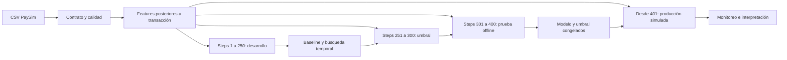

# Detección de fraude y monitoreo temporal

Proyecto independiente para el curso Machine Learning Engineering III. Objetivo: clasificar `isFraud` en transacciones simuladas PaySim y evaluar estabilidad y desempeño durante una reproducción cronológica de producción.

**Estado: preparación, baseline y optimización completados localmente.** Dos notebooks ejecutados, cuatro particiones verificadas y evidencia MLflow local. Se compararon veinte configuraciones de XGBoost en sesenta ajustes temporales y se guardó el candidato seleccionado. Todavía no hay umbral optimizado, evaluación offline final, aplicación de monitoreo ni release final. Los resultados de aprobación hipotecaria de V2 no se trasladan a este problema.

## Flujo



El límite 400/401 está exigido por la consigna; los cortes internos son una decisión de validación. Los saldos finales se usan porque el momento de detección se define después de registrar la transacción. No se promete prevención antes de autorizarla.

## Ejecución de la primera etapa

Desde la raíz del proyecto, con Python 3.12 o superior:

```powershell
python -m venv .venv
.\.venv\Scripts\python.exe -m pip install -r requirements-stage1.txt
Copy-Item .env.example .env
# Editar PAYSIM_CSV en .env con la ruta local al dataset.
.\.venv\Scripts\python.exe -m src.fraud.prepare
.\.venv\Scripts\python.exe -m unittest discover -s tests -v
.\.venv\Scripts\python.exe -m src.fraud.tracking
```

Abrir y ejecutar `notebooks/01_preprocesamiento.ipynb` desde la raíz o desde su carpeta. El notebook reutiliza el perfil si su hash coincide con el CSV; en caso contrario ejecuta de nuevo la preparación. No ajusta transformadores ni entrena modelos.

Para consultar MLflow local:

```powershell
.\.venv\Scripts\mlflow.exe ui --backend-store-uri sqlite:///mlflow.db --host 127.0.0.1 --port 5000
```

`reports/tracking_status.json` identifica el run real de preparación. El notebook también registra hashes y artefactos. No es evidencia de optimización todavía.

## DagsHub

Configurar en `.env` las tres variables de conexión indicadas en `.env.example` y seleccionar `MLFLOW_BACKEND=dagshub`. No subir este archivo ni compartir tokens en mensajes. Si falta autenticación, el backend remoto falla explícitamente; no se declara conectado por tener una URL pública.

Se reutilizó la configuración local de la V2 y, con autorización explícita del usuario, se publicó el baseline en el experimento independiente `fraud-baseline-temporal`. Se verificaron el run principal finalizado, los seis runs hijos y los artefactos del modelo. [Ver el run de baseline en DagsHub](https://dagshub.com/jorgesialer/Proyecto-mle-riesgo.mlflow/#/experiments/1/runs/00303d2bd7304de6868196341eff688d). GitHub remoto sigue pendiente; no se encontró una sesión guardada.

## Baseline temporal

```powershell
.\.venv\Scripts\python.exe -m pip install -r requirements-stage2.txt
.\.venv\Scripts\python.exe -m src.fraud.baseline
```

El CLI reutiliza la evidencia si coinciden hashes y parámetros. Compara DummyClassifier con un árbol de profundidad 6 en tres ventanas temporales, sin acceder a los bloques de umbral, test offline o producción. Ver [notebook de entrenamiento](notebooks/02_entrenamiento.ipynb) y [resultados](reports/baseline/STAGE2_RESULT.md).

En validación combinada: 1.646 fraudes detectados, 5 omitidos y 735 falsas alarmas, con umbral fijo 0,5. Son resultados del baseline en development, no resultados finales. Su contrato utiliza saldos posteriores a la transacción; no implica prevención ni desempeño en datos reales.

La publicación remota está implementada y ejecutada en `src/fraud/publish_baseline.py`: modelo baseline con un ejemplo de ocho filas, código y evidencias. No se publicó el CSV completo ni el archivo `.env`. Los identificadores y verificaciones están en `reports/baseline/remote_tracking.json`. No se modificaron los experimentos de aprobación crediticia y el baseline no está registrado como champion productivo.

## Documentación y evidencia

- [Diccionario y contrato](docs/DATA_DICTIONARY.md).
- [Plan y rúbrica](docs/PROJECT_PLAN.md).
- [Origen y reproducción de datos](data/README.md).
- [Notebook 1](notebooks/01_preprocesamiento.ipynb).
- [Resultado de la primera etapa](reports/STAGE1_RESULT.md).
- `reports/dataset_profile.json`: perfil y hashes de datos.
- `reports/01_preprocesamiento.html`: vista ejecutada del primer notebook, cuando se genere. No es el reporte final de monitoreo.
- `reports/environment-stage1.json`: versiones utilizadas en la ejecución verificada.

## Optimización completada

Random Search (RandomSampler de Optuna) y TPE se compararon con diez configuraciones cada uno, tres folds, mismo espacio y semilla. Se utilizó el encoder sin estadísticas aprendidas y manejo nativo de NaN para ambos. El [protocolo](docs/SEARCH_PROTOCOL.md) explica las decisiones y límites.

| Método | Mejor AP temporal media | Minutos de evaluación del objetivo |
| --- | ---: | ---: |
| Random Search | 0,997795 | 6,97 |
| TPE | 0,997233 | 8,99 |
| Árbol baseline | 0,994281 | Ver sus métricas por fold |

Se seleccionó XGBoost de Random Search con 90 árboles y profundidad 3. Es un resultado acotado con una semilla, no superioridad universal. El pipeline está ajustado únicamente sobre steps 1–250 y recargado con predicciones idénticas. El bloque del umbral, el test offline y producción siguen reservados.

Ver [resultados de etapa 3](reports/optimization/STAGE3_RESULT.md), el notebook 2 ampliado y su [versión HTML](reports/optimization/02_entrenamiento_optimizacion.html).

```powershell
.\.venv\Scripts\python.exe -m pip install -r requirements-stage3.txt
.\.venv\Scripts\python.exe -m src.fraud.optimize --trials 10 --threads 4
.\.venv\Scripts\python.exe -m src.fraud.candidate
```

El baseline ya está publicado en DagsHub. La publicación del nuevo candidato y de los veinte trials fue rechazada por la revisión automática al requerir autorización explícita adicional para ese payload. La etapa 3 está completa localmente; `src/fraud/publish_optimization.py` está preparado y no se ha ejecutado.

## Desarrollo pendiente

1. Publicación autorizada de los resultados de optimización.
2. Selección de umbral y evaluación offline final del modelo seleccionado.
3. SHAP global/local, importancia por permutación y PDP/ICE.
4. Monitoreo de calidad, data drift, predicciones, desempeño y señales de concept drift; app Streamlit y HTML.
5. Publicación autorizada de evidencia, documentación final, PR integrada y release v1.0.0.

No se ha acreditado la existencia de ramas remotas, PR, despliegues o enlaces de experimentos nuevos. Se añadirán cuando estén verificados.
