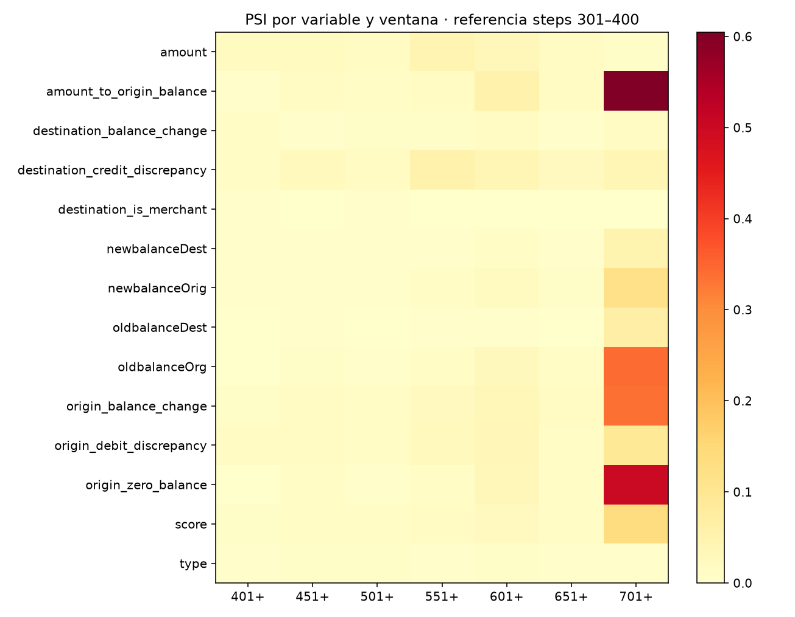
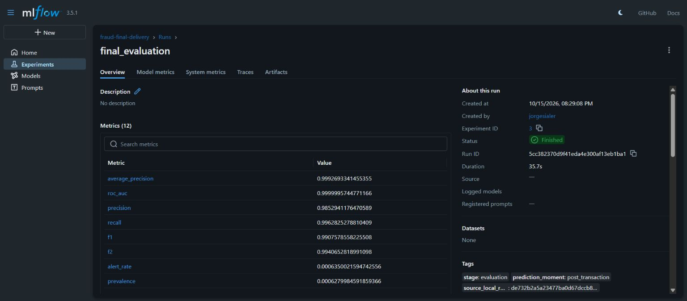
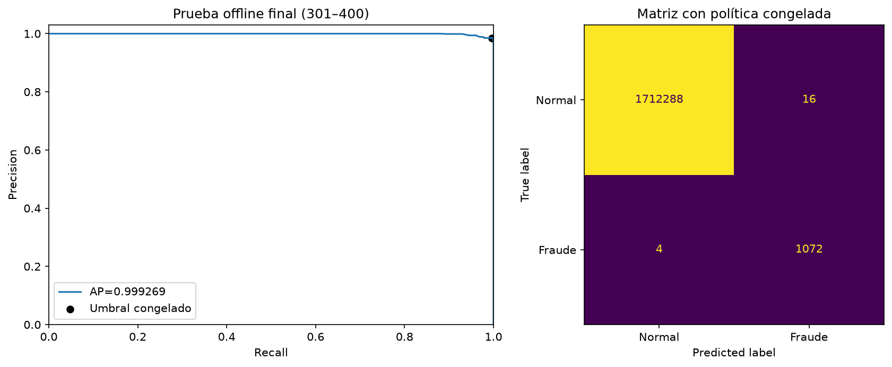

# Evidencias del proyecto

Estas capturas muestran la aplicación y los registros de MLflow. Los gráficos de evaluación e interpretación se generaron con los resultados guardados.

## 1. Desempeño en producción simulada

El panel reúne las 575.590 transacciones de los steps 401–743: 3.715 fraudes detectados, 21 omitidos y 7 falsas alarmas. El selector permite revisar cada ventana.

## 2. Cambios en las variables

La pestaña de calidad y drift muestra siete alertas de variable/ventana, concentradas en la última ventana. Sirven para investigar cambios; no demuestran por sí solas que haya cambiado la relación entre las variables y el fraude.

El mapa completo permite revisar todas las variables:

## 3. Métricas en MLflow

La búsqueda aleatoria quedó registrada con diez configuraciones y tres folds. La mejor AP temporal media fue 0,997795. El notebook 02 compara estos resultados con TPE.

El tiempo de búsqueda está en `objective_seconds` (418,31 segundos). El campo Duration de este run remoto corresponde a la publicación de los resultados, realizada después del entrenamiento local.

El [experimento final](https://dagshub.com/jorgesialer/Proyecto-mle-riesgo.mlflow/#/experiments/3/runs/5cc382370d9f41eda4e300af13eb1ba1) contiene las métricas del test offline y el umbral. Los steps 301–400 no se usaron para elegir los parámetros.

## 4. Modelo registrado

La versión 1 de `fraud-paysim-posttransaction` es el modelo usado para el monitoreo. La etapa Production corresponde a la simulación con PaySim; la aplicación funciona localmente.

## 5. Evaluación e interpretación

La matriz de confusión muestra los aciertos y errores del test. SHAP resume la contribución de las variables y permite revisar casos individuales en el notebook 03.

## 6. Código y entrega

Las ramas `main` y `development` conservan el desarrollo. La [PR inicial](https://github.com/jorgesialer/Proyecto-mle-fraude/pull/1) integra el análisis completo. Los cambios de presentación no vuelven a entrenar el modelo ni cambian las métricas. La [release 1.0.0](https://github.com/jorgesialer/Proyecto-mle-fraude/releases/tag/1.0.0) conserva la primera entrega.
